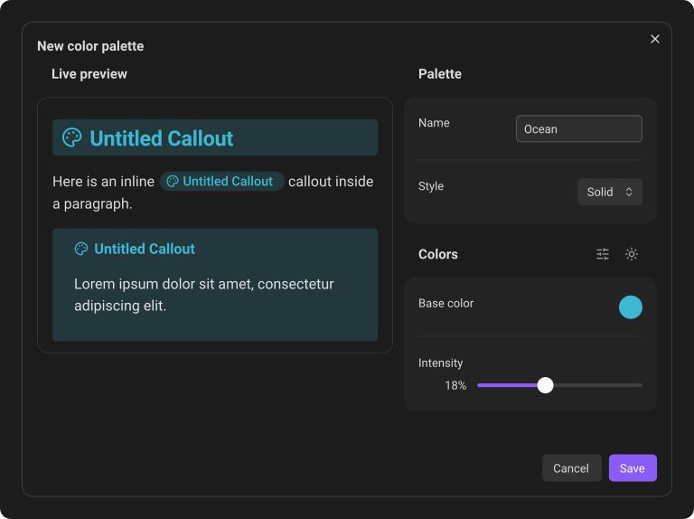
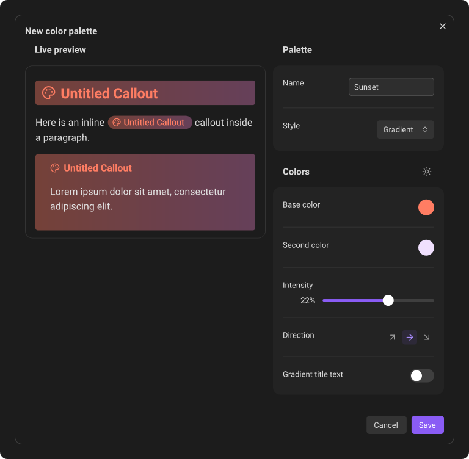

# Custom color palettes

Callout Studio includes Obsidian's native callout colors and its own built-in presets. To change a callout's color, open that callout for editing and use the color menu.

The color menu lists the built-in colors in two groups:

- **Obsidian callouts**: Blue, Cyan, Green, Orange, Red, Purple and Gray, the colors of Obsidian's own callouts with Obsidian's exact shades.
- **Color presets**: Coral, Yellow, Teal, Sky, Indigo, Grape, Plum, Pink and Brown.

Violet is now called Purple, and Bubblegum is now called Pink. Callouts that used them keep their color and show the new name.

Amber, Lime and Crimson are no longer in the menu: Yellow takes the place of the first two and Red of Crimson. Callouts that already use one of them keep their exact color, and the color menu still shows its name. If you want to choose one of them again, save it as a palette of your own.

Hovering a colour temporarily previews it. Moving the pointer away from the
row restores the current colour; click a row or use the arrow keys and Enter
to choose it. If the pointer rests over one row while you use the arrow keys,
only the keyboard's row is highlighted. Move the pointer again to return the
highlight and preview to the row under it.
Group headings stay visible at the top of the color menu as you scroll.

## Create a saved palette

Open the plugin settings, open **Saved color palettes** (the first row of the **Colors and icons** box, which also holds **Icon libraries**), and click **+** above the list (on a phone or tablet, the **New palette** row at its end).

1. Give the palette a name.
2. Choose a **Base color**. The background initially follows that color automatically. A new palette starts on a default blue; if you already have a palette with exactly that look, it starts on a blue one shade off, so the window never opens on a "duplicate" message.
3. If you want to set the colors one by one, click the sliders button at the end of the **Colors** heading. It opens an **Accent color**, a **Background color** and a **Text color** (the color of the text inside the callout). Light mode and dark mode each keep their own three colors, and the rows set the ones for the mode Obsidian is showing. Both start from what the base color gave them, so the mode you haven't changed still looks right. The same button, now an undo arrow, goes back to a single base color and drops the colors you set by hand. It is there only while the background style is **Solid**.
4. To see or set the other mode, click the sun or moon button at the very end of the **Colors** heading. All of Obsidian switches to that mode while the window is open, so the preview shows exactly how your notes will look in it, theme included. Closing the window switches back, and Obsidian's own setting never changes. The button is there with every background style, so you can also check a base color or a gradient in the other mode.
5. Review any contrast warning: a small warning triangle appears beside the Accent or Text color that has low contrast against the background, and a line under the three colors says it may be hard to read. The triangle follows the color as you drag it; the line appears once you let go. It checks the mode on screen. It does not prevent you from saving the design.
6. Click **Save**.

In dark mode, a background darker than the page, such as black, shows exactly as you chose it, in Reading view as well as in Live Preview.

**Save** stays dimmed while the name is already used by another palette, or while the colors are identical to another palette's. Press it and a message says which.

The built-in colors count too, with one exception. A palette you saved before a built-in color took its name or colors keeps them. For example, a palette called **Pink** from before the Pink preset still saves under that name.

Saved palettes appear at the top of every callout color menu under **Custom**.

A palette's name also gives it a word for callout metadata: **Comic Red** is `comic-red`. Write `[!note|comic-red]` to give one callout this palette. **Save** stays dimmed when you give a palette a word another saved palette already has. Two palettes saved before metadata words existed can share one, such as **Note dark** and **Note (dark)**. They still save, and a line under the name says that only one of them answers to the word. See [Callout metadata](18-callout-metadata.md).

## Background styles

The **Style** menu offers three choices:

- **Solid** uses a single background color.
- **Gradient** adds a second color and a direction control. You can also enable **Gradient title text**.
- **Transparent** removes the callout's background, including a tinted title bar or a content panel your theme would otherwise draw, while keeping the base color on the title and icon. The theme's borders and small decorations stay.

In the palette editor, **Name** and **Style** have the same rounded field shape
and hover and focus feedback as other text and selection fields. Open
**Style** to choose from the list; it does not accept typed text.

Some themes and Style Settings layouts keep a callout's body neutral and put its
color somewhere else - AnuPpuccin's Sleek, Vanilla Normal, and Vanilla Plus
layouts put it on a title bar. Block callouts follow the layout: the body keeps
the theme's neutral surface in light and dark mode, and the palette's
background, solid or gradient, fills the title bar instead. A transparent
palette leaves the title bar empty.

Layouts that give callouts no background at all, such as GitHub Theme's callout
style or Minimal's outlined callouts, show neither a solid nor a gradient
background; the palette's base color still colors the title, icon, and frame.

## Edit, delete, and restore palettes

Click the pencil beside a saved palette to edit it. When you save the changes, every callout linked to that palette updates across the vault.

To delete a palette, click its **✕**, or select its row and press **Delete**. Callout Studio asks first, and says how many callouts are linked to it.

If the new name changes the palette's metadata word and your notes use the old one, Callout Studio asks whether to update those notes. It doesn't ask when the old word also means something else: a built-in color's word, such as `pink` for a palette called **Pink**, or a word your theme or a CSS snippet styles. Those notes stay as they are and take that other meaning.

Deleting a palette never changes your notes. Callouts that name it in their metadata go back to their own color, or take the built-in color of that name when there is one.

Deleting a palette does not change the callouts that already use it. They keep their exact colors. The callout editor's **Color** row shows the color circles and the message “This callout's saved color was deleted.” Click **Restore** beside the message to open the palette save popup with those colors filled in.

Clicking the color field and then clicking away keeps **Deleted color**, the warning, and the color circles visible. When the color list opens, no saved color is highlighted until you point to one or move through the list with the keyboard. The deleted state also remains if you cancel the restore popup. Save a palette or choose another color to leave this state.

---
**Next:** [Custom icons & emojis](04-custom-icons-and-emojis.md)
