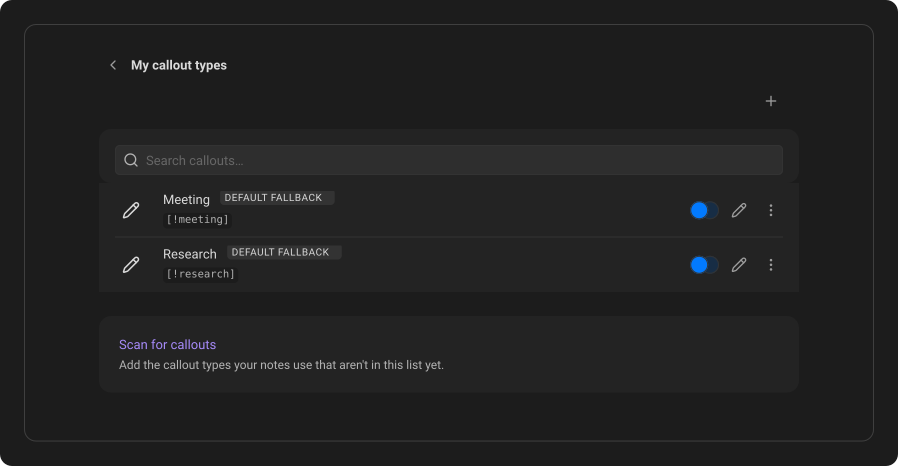
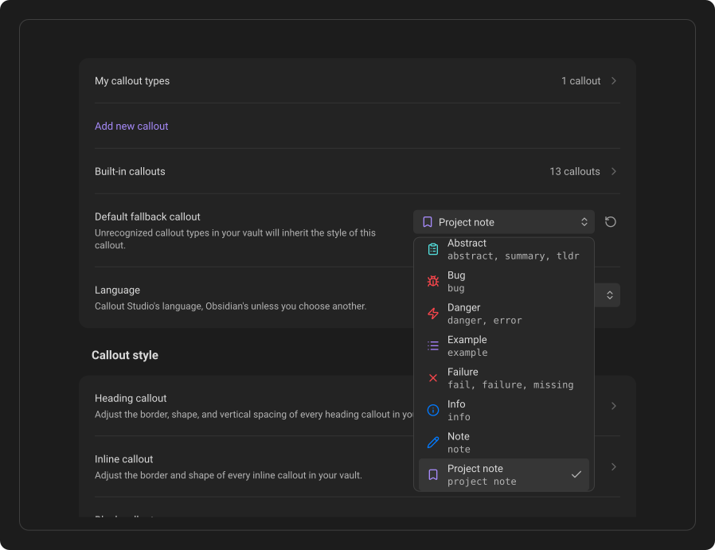

# Fallback styles & discovery

Callout Studio saves only the callout types you explicitly create, import, or discover. Typing an unknown callout in a note, or pasting text that contains one, does not add a permanent definition to your settings.

## Discover callouts already in your vault

Open **Settings → Callout Studio → My callout types** and click **Scan for callouts**, below the list. Callout Studio scans your saved notes and adds types that are not already in the list. It does not alter notes, overwrite existing types, or change your custom styles. While a scan runs, the row says **Scanning…**. The new types appear in the list together with the message that says how many were added.

To create just one unknown type directly, right-click it in the note and choose
**Create new callout**. The editor keeps the ID from that token, ready for you to
review and style it.

## Choose the fallback appearance

An unknown callout still receives the **Default fallback** appearance. By
default, that is Obsidian's **Note** appearance, marked with the **Default**
label. A saved callout that follows that style instead of having its own is
marked **Auto**.

For a standard Block callout, this is a gentle baseline for its color,
background, icon, and optional content color. An exact callout rule in your
theme or an enabled CSS snippet takes precedence, including its native icon;
Callout Studio does not register or import that snippet as a callout definition.
Strong global
geometry such as Callout Studio's border, radius, scaling, and alignment is
applied only after the type is saved in Callout Studio. Unknown Heading and
Inline tokens remain Callout Studio surfaces and use the full fallback design.

To change it, find **Default fallback callout** in the settings and choose the style that unknown callouts should inherit. The fallback can be one of your own custom callouts.

A callout that only your theme defines can't be the fallback, so it isn't in the picker. The fallback is saved in your settings and synced to your other devices, but the theme's callout exists only on a device where that theme is active. On any other device the setting would point at nothing. To use one, save it first with **Scan for callouts** or an import. It then belongs to Callout Studio and appears in the picker.

After choosing a different fallback, click **Reset to default** beside the picker to select **Note** again.

Deleting the callout you chose as the fallback also selects **Note** again. Callout Studio asks before that delete, and its **Undo** makes the callout the fallback once more.

A callout you delete while notes still use it becomes an unknown callout like any other: it takes the fallback appearance, and **Scan for callouts** can find it again. See [Delete a custom callout](06-editing-replacing-and-deleting.md#delete-a-custom-callout). The same goes for an ID you remove from a callout and choose to leave in your notes. See [Remove, rename or move an ID](06-editing-replacing-and-deleting.md#remove-rename-or-move-an-id).

## Apply or leave the fallback style

To make an existing saved callout follow the fallback, open its three-dot menu and choose **Use default fallback style**, marked with a circular arrow. Its icon and color immediately match the fallback. To get its own design back, choose **Undo** in the notice that appears. Undo does nothing if you have edited the callout since.

To make it independent again, edit any part of its design. The **Auto** label disappears, and later fallback changes no longer change that callout.

Theme-provided callouts are handled separately because the active theme controls their appearance. See [Theme integration](17-theme-integration.md).

---
**Next:** [Editing, replacing & deleting](06-editing-replacing-and-deleting.md)
