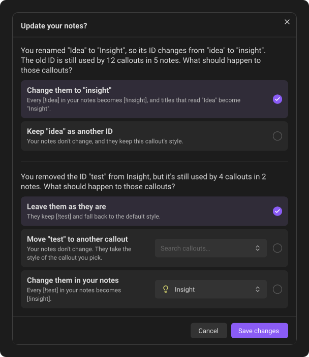
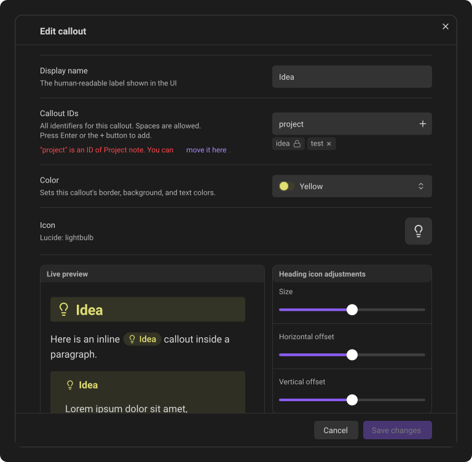

# Editing, replacing & deleting

Changes to a callout's color, icon, name, or IDs take effect everywhere the callout appears. Your notes themselves change only when you say so: if saving would change something they hold, Callout Studio asks first. See [Remove, rename or move an ID](#remove-rename-or-move-an-id).

A callout's three-dot menu groups its actions, with a line between groups:

1. **Find callouts**, with the number of uses.
2. **Replace in vault…** and **Convert uses to plain text**, which change your notes.
3. **Duplicate**, **Reset to default** or **Use default fallback style**, which change the callout itself.
4. **Delete**, in red.

A row shows only the actions that apply to it, and a group with nothing in it leaves no line. When the count shows that no note uses the callout, **Find callouts (0)** is greyed out. If the count arrives after the menu opened and it is 0, **Replace in vault…** and **Convert uses to plain text** are greyed out too.

On desktop and tablet, a callout's three-dot menu closes when you scroll the
settings list or resize the window. On a phone, Obsidian opens the menu at the
bottom of the screen; it opens and stays open even as the keyboard closes and
the page adjusts. Rotating the device or leaving Settings closes the menu on
every device. You can still scroll inside a long menu. Scrolling the settings
list also cancels a menu that is still waiting to open, on any device. Open the
three-dot menu again when you need it.

## Edit a callout

Click the pencil beside a callout to open its editor. Save the new color, icon, name, IDs, or icon adjustments when you are finished.

When you customize one of Obsidian's thirteen built-in callouts, small return arrows appear beside changed IDs, icons, and colors. Each icon-adjustment card also gets its own return arrow when its sliders change; it resets the size and both offsets for that callout format without touching the other two formats. To undo every customization on that built-in type at once, open its three-dot menu and choose **Reset to default**.

Resetting **Callout IDs** restores Obsidian's original ID and aliases. Custom aliases it removes leave the callout when you save; if your notes use them, Callout Studio asks what should happen to those notes first, as for any ID you remove. If another callout already uses one of the original aliases, the draft stays unchanged and the IDs field shows the conflict.

**Reset to default** in the three-dot menu removes the IDs you added, too. If your notes use one, it first opens **Update your notes?**:

- **Leave them as they are** is chosen when the window opens. Your notes don't change. Callouts written with an ID you added fall back to the default style.
- **Change them to** rewrites them to one of the built-in callout's own IDs and offers **Undo**.

The window's **Reset to default** button resets the callout with your answer. **Cancel** changes nothing.

## Remove, rename or move an ID

Saving never changes your notes behind your back. When a change you made in the editor touches callouts already in your notes, **Save changes** first opens **Update your notes?**. It lists what you changed, such as an ID you removed, or a new display name that changes the callout's main ID with it. It then says how many callouts in how many notes this affects, and asks one question about all of it:

- **Leave them as they are** is chosen when the window opens. Your notes don't change. Callouts written with an old ID, such as `[!test]`, fall back to the default style, like any callout type Callout Studio doesn't know.
- **Change them to** rewrites every old ID in your notes to one of this callout's own IDs, the main ID unless you pick another from the box beside it. Like **Replace in vault…**, it also changes titles Callout Studio wrote to match, such as *Idea* to *Insight*. A title you wrote yourself stays.

When only the display name changed and the ID stayed the same, the question is about titles that still read the old name: **Leave them as they are**, or **Change them to** the new name.

Press **Save changes** to save with your answer, or **Cancel** to go back to the editor with nothing saved. If no note uses what you changed, nothing is asked. If some notes can't be read, the window still asks, without numbers.

To keep an old ID working without changing your notes, add it back in the **Callout IDs** field before you save; then it isn't leaving, and nothing is asked. To give it to another callout instead, see [Move an ID to another callout](#move-an-id-to-another-callout).

When notes were changed, the notice offers **Undo** for a few seconds. Undo puts back the notes, unless you've edited them since; it doesn't undo the edit to the callout. An ID you removed stays removed, so notes put back to it fall back to the default style until you add the ID again.

### Move an ID to another callout

An ID belongs to one callout. If you type one that another callout has, the IDs field says which callout it belongs to. When it can move, the message offers **move it here**: the ID joins this callout, and a note under the field says it moves when you save. On **Save changes**, the other callout gives the ID up and this one takes it. No note changes: callouts written with that ID simply take this callout's style.

You can also do it in two steps: remove the ID from the callout that has it and choose **Leave them as they are**, then add the ID to the other callout. Your notes don't change either way.

- **To make an ID a callout of its own**, create a new callout with that name, then choose **move it here**.
- **To make a callout an extra ID of another one**, delete it first (its notes are not touched), then add its ID to the other callout.
- **Some IDs can't move**: the IDs Obsidian gives its built-in callouts, IDs your theme draws, and another callout's first ID. The message says which.

## Duplicate a custom callout

Open a saved custom callout's three-dot menu and choose **Duplicate**. The copy keeps the original's complete saved appearance and settings, including its icon adjustments and any link to a deleted color palette. A deleted palette stays marked as **Deleted color** in the copy's editor.

The copy receives a new name and ID ending in `copy`, then `copy 2`, `copy 3`, and so on when needed. Additional IDs receive their own unique copy suffixes. Long names and IDs are shortened to leave room for the suffix. Existing callouts in your notes keep using the original.

After the copy is saved, its section opens and the list shows enough items to reveal it immediately, with a notification confirming success. If duplication fails, an error notification appears. No incomplete copy is added; if a later saving step fails after the complete copy has reached storage, that valid copy is kept.

**Duplicate** is available for saved custom callouts; Obsidian's built-in callouts and callouts supplied only by a theme do not offer it.

## Replace a callout across the vault

Use **Replace in vault** when every use of one type should become another:

1. Open the callout's three-dot menu.
2. Choose **Replace in vault**.
3. Select the replacement callout. You can type to filter the list; pressing **Enter** selects the top match.
4. Choose **Replace**.

**Replace** stays dimmed until you have chosen the callout to replace it with. Press it and a message says what to choose.

On desktop, the replacement search is ready for typing when the window opens. On a phone or tablet, tap it to bring up the keyboard.

Callout Studio updates matching Block, Heading, and Inline callouts throughout the vault while keeping their content. The change edits your notes directly, so **Enter** never starts it; only the **Replace** button does.

When it finishes, the notice offers **Undo** for a few seconds. Undo puts back every note the replacement changed, unless you've edited that note since; those are left as they are, and the message says how many. Only the most recent replacement or conversion can be undone, and only until Obsidian is closed.

## Delete a custom callout

Choose **Delete** from the same three-dot menu. Delete removes the callout's definition from your list and never changes a note.

- If no note uses the callout, it is deleted right away.
- If notes use it, Callout Studio first says how many times and in how many files, and asks you to confirm. Those callouts stay in your notes exactly as you wrote them; they just fall back to the default style, the same look as any callout type Callout Studio doesn't know.
- If the callout is your **Default fallback callout**, Callout Studio always asks first, even when no note uses it. Deleting it makes Note the fallback, so every callout without a style of its own changes look.

The notice that follows offers **Undo** for a few seconds. Undo brings the callout back with its icon and colors, and makes it the fallback again if it was one. If you've made a new callout with the same ID in the meantime, Undo leaves the new one alone.

Notes that still use a deleted callout keep it, so **Scan for callouts** finds it again and adds it back to your list, without its old design. Importing it again, for example from Callout Manager, also brings it back.

Obsidian's built-in callout types are permanent and cannot be deleted. To undo your changes to one, choose **Reset to default**. Callout types your theme supplies cannot be deleted either. Both still offer **Replace in vault** and **Convert uses to plain text**.

While saving is paused, Delete is unavailable: the deletion couldn't be saved, so the callout would come back the next time Obsidian starts.

## Convert a callout's uses to plain text

To remove a callout from your notes but keep its text, choose **Convert uses to plain text** from the three-dot menu. Every kind of callout offers it, as long as a note uses it.

Callout Studio says how many times the callout appears and in how many files, and asks you to confirm. Each use then becomes ordinary text:

- **Block callout:** the `[!type]` marker goes, and the callout's title stays as a line of its own above its content. If text sat right above a callout with no blank line between them, a blank line is added so the two stay separate paragraphs.
- **Heading callout:** `## [!type] Title` becomes `## Title`. A heading with no title of its own keeps the type as the note writes it: `## type`.
- **Inline callout:** `[!type]{text}` keeps only its text. Without `{text}`, the type stays as the note writes it: `[!type]` becomes `type`.

Heading and inline callouts follow the same rules as **Convert to standard Markdown** in the [Danger zone](14-danger-zone.md). An inline callout that can't be read safely, such as one with another inline callout inside its `{…}`, is left unchanged.

The callout type itself stays in your list. To remove it as well, choose **Delete** afterwards: with no uses left, it's deleted right away.

If some notes cannot be updated, Callout Studio reports the incomplete work; the notes it already converted stay converted. Resolve the file or sync problem and run the action again to finish.

When it finishes, the notice offers **Undo**. It puts back every note the conversion changed, unless you've edited that note since.

---
**Next:** [Global styling](07-global-styling.md)
