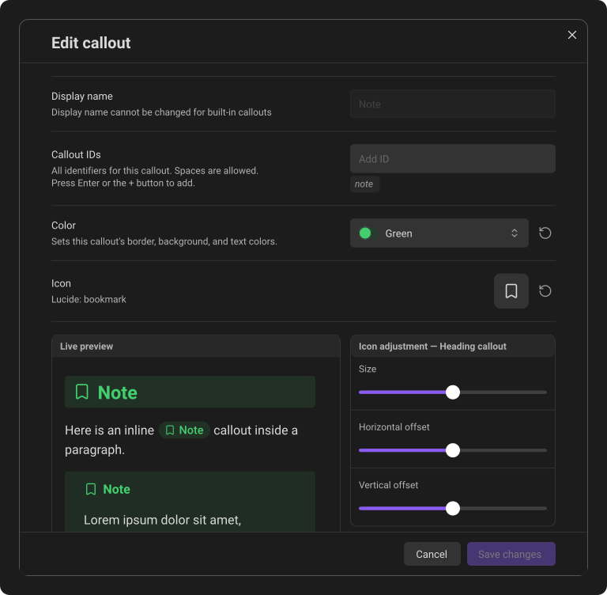
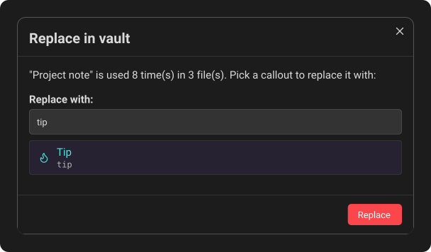

# Editing, replacing & deleting

Changes to a callout's color, icon, name, or ID take effect across the vault. Callout Studio updates the definition and, when necessary, rewrites matching note tokens so existing notes keep working.

On desktop and tablet, a callout's three-dot menu closes when you scroll the
settings list or resize the window. On a phone, Obsidian opens the menu at the
bottom of the screen; it stays open as the keyboard closes and the page adjusts.
Rotating the device or leaving Settings closes the menu on every device. You
can still scroll inside a long menu. Scrolling the settings list also cancels
a menu that is still waiting to open on any device; it will not appear after
its row has moved. Open the three-dot menu again when you need it.

## Edit a callout

Click the pencil beside a callout to open its editor. Save the new color, icon, name, IDs, or icon adjustments when you are finished.

When you customize one of Obsidian's thirteen built-in callouts, small return arrows appear beside changed IDs, icons, and colors. Each icon-adjustment card also gets its own return arrow when its sliders change; it resets the size and both offsets for that callout format without touching the other two formats. To undo every customization on that built-in type at once, open its three-dot menu and choose **Reset to default**.

Resetting **Callout IDs** restores Obsidian's original ID and aliases. Any custom aliases it removes are rewritten to the primary ID in your notes when you save, so existing callouts keep working. If another callout already uses one of the original aliases, the draft stays unchanged and the IDs field shows the conflict.

## Duplicate a custom callout

Open a saved custom callout's three-dot menu and choose **Duplicate**. The copy keeps the original's complete saved appearance and settings, including its icon adjustments and any link to a deleted color palette. A deleted palette stays marked as **Deleted color** in the copy's editor.

The copy receives a new name and ID ending in `copy`, then `copy 2`, `copy 3`, and so on when needed. Additional IDs receive their own unique copy suffixes. Long names and IDs are shortened to leave room for the suffix. Existing callouts in your notes keep using the original.

After the copy is saved, its section opens and the list shows enough items to reveal it immediately, with a notification confirming success. If duplication fails, an error notification appears. No incomplete copy is added; if a later saving step fails after the complete copy has reached storage, that valid copy is kept.

**Duplicate** is available for saved custom callouts; Obsidian's built-in callouts and callouts supplied only by a theme do not offer it.

## Replace a callout across the vault

Use **Replace in vault** when every use of one type should become another:

1. Open the callout's three-dot menu.
2. Choose **Replace in vault**.
3. Select the replacement callout. You can type to filter the list; pressing **Enter** selects the top match.
4. Choose **Replace**.

**Replace** stays dimmed until you have chosen the callout to replace it with. Press it and a message says what to choose.

On desktop, the replacement search is ready for typing when the window opens. On a phone or tablet, tap it to bring up the keyboard.

Callout Studio updates matching Block, Heading, and Inline callouts throughout the vault while keeping their content. The change edits your notes directly, so **Enter** never starts it; only the **Replace** button does.

When it finishes, the notice offers **Undo** for a few seconds. Undo puts back every note the replacement changed, unless you've edited that note since; those are left as they are, and the message says how many. Only the most recent replacement or conversion can be undone, and only until Obsidian is closed.

## Delete a custom callout

Choose **Delete** from the same three-dot menu. Delete removes the callout's definition from your list and never changes a note.

- If no note uses the callout, it is deleted right away.
- If notes use it, Callout Studio first says how many times and in how many files, and asks you to confirm. Those callouts stay in your notes exactly as you wrote them; they just fall back to the default style, the same look as any callout type Callout Studio doesn't know.
- If the callout is your **Default fallback callout**, Callout Studio always asks first, even when no note uses it. Deleting it makes Note the fallback, so every callout without a style of its own changes look.

The notice that follows offers **Undo** for a few seconds. Undo brings the callout back with its icon and colors, and makes it the fallback again if it was one. If you've made a new callout with the same ID in the meantime, Undo leaves the new one alone.

Notes that still use a deleted callout keep it, so **Scan for callouts** finds it again and adds it back to your list, without its old design. Importing it again, for example from Callout Manager, also brings it back.

Obsidian's built-in callout types are permanent and cannot be deleted. To undo your changes to one, choose **Reset to default**. Callout types your theme supplies cannot be deleted either. Both still offer **Replace in vault** and **Convert uses to plain text**.

While saving is paused, Delete is unavailable: the deletion couldn't be saved, so the callout would come back the next time Obsidian starts.

## Convert a callout's uses to plain text

To remove a callout from your notes but keep its text, choose **Convert uses to plain text** from the three-dot menu. Every kind of callout offers it, as long as a note uses it.

Callout Studio says how many times the callout appears and in how many files, and asks you to confirm. Each use then becomes ordinary text: the `[!type]` marker goes, and the callout's title stays as a line of its own above its content. If text sat right above a callout with no blank line between them, a blank line is added so the two stay separate paragraphs.

The callout type itself stays in your list. To remove it as well, choose **Delete** afterwards: with no uses left, it's deleted right away.

If some notes cannot be updated, Callout Studio reports the incomplete work; the notes it already converted stay converted. Resolve the file or sync problem and run the action again to finish.

When it finishes, the notice offers **Undo**. It puts back every note the conversion changed, unless you've edited that note since.

---
**Next:** [Global styling](07-global-styling.md)
