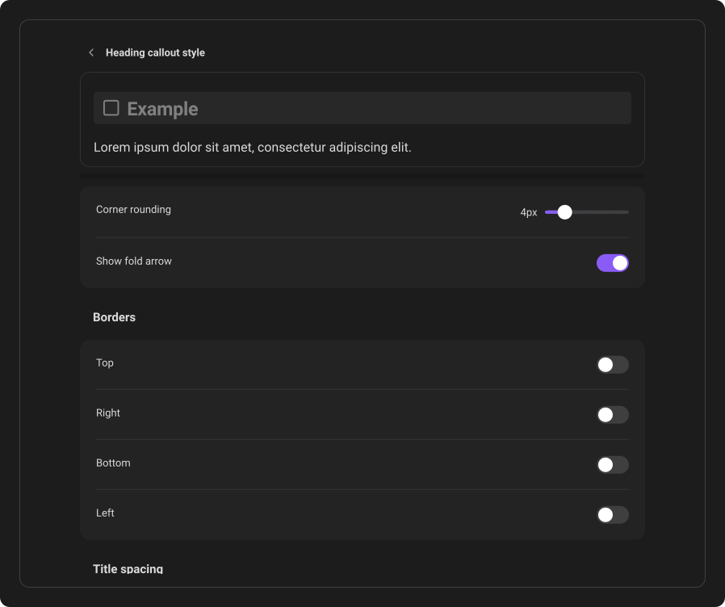
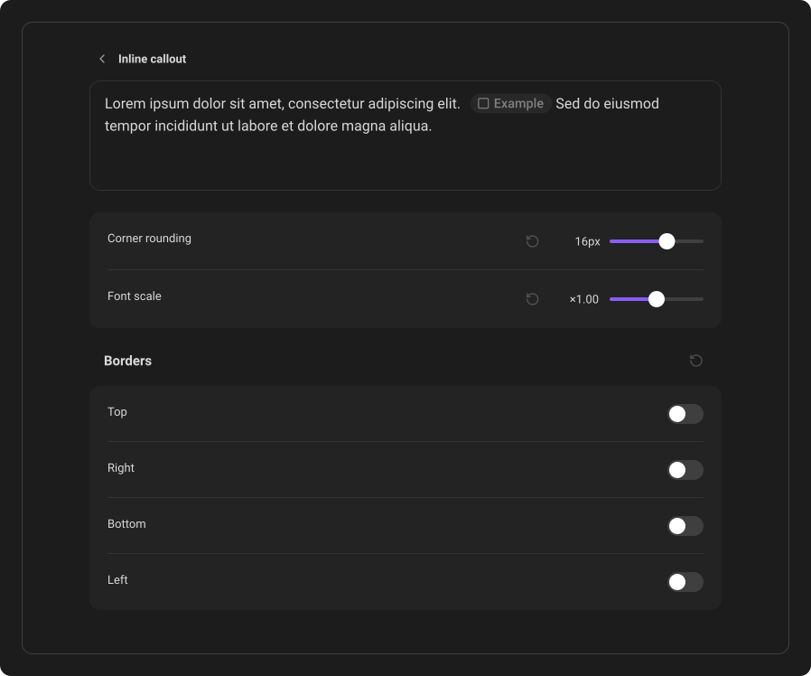
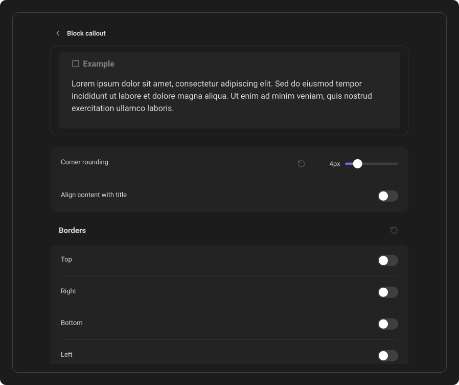

# Global styling

Global styling gives every Callout Studio callout a consistent shape and layout. Open the plugin settings and, under **Global styling**, open **Heading callout style**, **Inline callout style** or **Block callout style**. Changes apply immediately across the vault.

Each callout format has its own page, so changing one format does not force the others to use the same geometry. A short live preview sits at the top of the page and stays exactly in place while you scroll through the controls, with the rows fading out as they slide under it (on a phone it scrolls with the page). While you hold the **Spacing between headers** slider, a stack of headers replaces the preview inside the same box, so the page does not shift under your hand.

Each slider has its own **Reset to default** arrow (↺) before its value. A box with several controls, such as **Borders**, also has one in its heading, which restores the whole box. An arrow shows only once something differs from the default, and is invisible until then. Other boxes and callout formats keep their values.

Borders are four switches, **Top**, **Right**, **Bottom** and **Left**. **Border thickness** appears once at least one side is on.

You can also reach every control from Obsidian's **Search settings…** field: try "corner", "border" or "title size".

## Heading callouts

For heading callouts, you can:

- Show borders on selected sides.
- Set the exact border thickness.
- Adjust vertical padding and the spacing between headings (**Title spacing**).
- Control corner rounding, and whether the fold arrow shows (**Show fold arrow**).

## Inline callouts

For inline callouts, you can:

- Scale the pill text independently of the rest of the note.
- Adjust corner rounding up to 25px to keep the pill rounded at larger text sizes.
- Choose border sides and thickness.

The icon and spacing scale with the pill text. At every inline text scale, the
entire pill stays centered vertically in the surrounding line instead of
shrinking toward the text baseline.

The Inline preview shows a localized example pill between two sample
sentences. Click it to reveal its Markdown syntax in the preview editor, using
the translated label.

## Block callouts

Block callouts include the broadest set of controls:

- Border sides, thickness, and corner rounding.
- Separate title and content scale.
- **Align content with title**, which starts the content text at the same inline edge as the title text, in both left-to-right and right-to-left layouts. The spacing follows the icon's width, including wider images.

These settings shape callouts drawn by Callout Studio. If your active theme owns a callout, the theme keeps control of its appearance; see [Theme integration](17-theme-integration.md). Turn off **Use your theme's callout styles** and Callout Studio draws every callout, with these global settings included; see [Turning your theme's callout styles off](17-theme-integration.md#turning-your-themes-callout-styles-off).

---
**Next:** [The right-click menu](08-the-right-click-menu.md)
