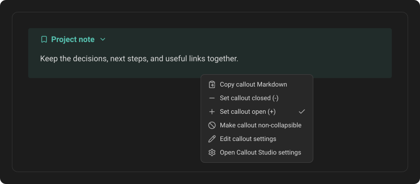
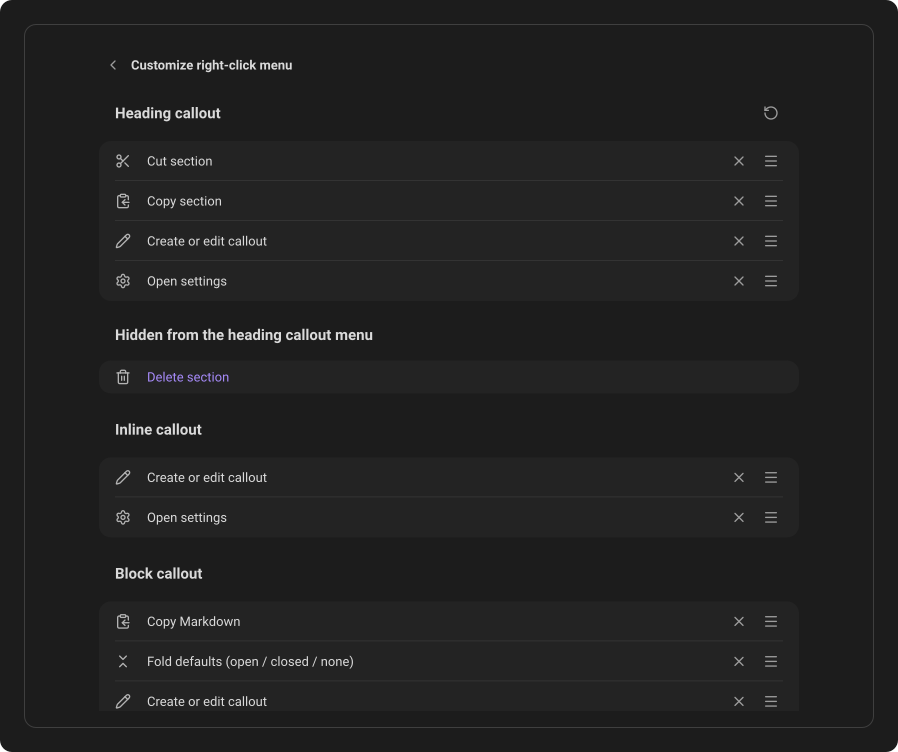

# The right-click menu

Right-click a callout in a note to open actions for that callout. The available items depend on whether it is a Heading, Inline, or Block callout.

The callout-type action adapts to the token under the pointer. A saved type
shows **Edit callout settings**. An unknown type shows **Create new callout** and
opens a new editor with that token's ID already filled in.

## Heading callouts

A heading callout's actions can work on the entire section below that heading:

- Cut the section.
- Copy the section.
- Delete the section. Like every Delete in Obsidian's menus, it is red.
- Create or edit the callout type.
- Open the main Callout Studio settings.

The section ends at the next heading of the same or a higher level.

## Inline callouts

An inline callout keeps the menu simple:

- Create or edit the callout type.
- Open the main Callout Studio settings.

## Block callouts

A block callout offers:

- Copy the callout's Markdown.
- Change its folding state between open, closed, and non-collapsible. All three states are listed, and a check mark shows the one the callout is in now.
- Create or edit the callout type.
- Open the main Callout Studio settings.

## Customize the menu

Open **Settings → Callout Studio**, then **Customize right-click menu** under **Menus and commands**. The page is laid out like Obsidian's own ribbon settings: for each callout format, a list of the actions its menu shows, in their order, each with its icon. Every change is saved immediately.

- **Reorder** an action by dragging its handle (≡). It works like Obsidian's own lists: the row lifts, and a slot in your accent colour shows where it will land. On a touch screen, press and hold the row first. With the keyboard, focus a row and press **Alt+↑** or **Alt+↓**.
- **Hide** an action with its **✕**. It moves to the list below, **Hidden from the … menu**, which shows only while a format hides something.
- **Bring an action back** by clicking it in that list. It returns at the end of the menu.
- **Reset** with the arrow (↺) in a format's heading. It shows every action of that format again, in the original order. The other formats keep their settings.

**Create or edit callout** is a single action here. At most one of its two
runtime labels appears in a note: **Edit callout settings** for a saved type or
**Create new callout** for an unknown one.

Obsidian's **Search settings…** finds this page by its name, as it finds the ribbon page.

---
**Next:** [Commands & hotkeys](09-commands-and-hotkeys.md)
