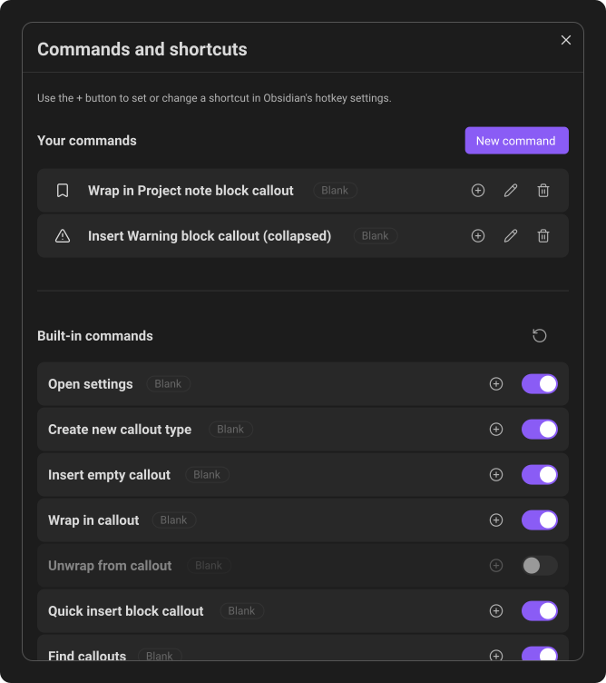
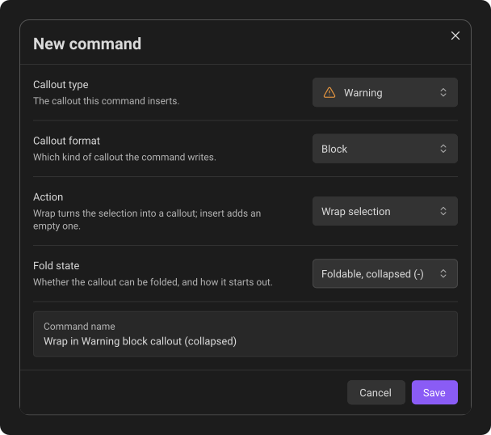

# Commands & hotkeys

Callout Studio adds commands to Obsidian's Command Palette. Press `Ctrl+P` on Windows or Linux, or `Command+P` on macOS, then search for **Callout Studio**.

The built-in commands are:

- **Callout Studio: Open settings**
- **Callout Studio: Create new callout type**
- **Callout Studio: Insert empty callout**
- **Callout Studio: Wrap in callout**
- **Callout Studio: Unwrap from callout**
- **Callout Studio: Quick insert block callout**
- **Callout Studio: Find callouts**

The three commands that edit note text - **Insert empty callout**, **Wrap in
callout**, and **Unwrap from callout** - appear in the Command Palette when a
Markdown note is open in an editing mode and its text editor is focused. They
are unavailable in Reading view or when focus is in a surface without an active
note editor.

No keyboard shortcut is assigned by default.

## Insert an empty callout

Run **Callout Studio: Insert empty callout** to start a new callout at the cursor, then choose its type from the list that opens. It never changes the text that is already there. Where the cursor is decides which kind of callout you get:

| Cursor | You get |
| --- | --- |
| On an empty line | A block callout in that line's place |
| At the start of a heading, before or on its `#` marks | A heading callout: `## [!tip] My heading` |
| Anywhere in a line of text | An inline callout at the cursor: `Some [!tip] text` |

Where an inline callout cannot go - in code, at the very start of a quoted line, on a block callout's first line, or right before `{` - you get a block callout on a new line below, as before. You also get a block callout while inline callouts are turned off. On a heading that is already a heading callout, a message says so and nothing changes.

A block callout that would touch the text above or below it gets a blank line in between, so neither is pulled into the other. Inside a callout, the new one is nested in it. It never writes into the note's properties: with the cursor there, the callout goes where the note's text begins.

## Wrap text after writing it

Select text and run **Callout Studio: Wrap in callout**. Choose a callout type from the list that opens, and Callout Studio turns the selection into a callout. Which kind depends on what you selected:

| Selection | You get |
| --- | --- |
| A heading, or the cursor on one | A heading callout: `## My heading` becomes `## [!tip] My heading`. Selecting the whole line, with its `#` marks, counts too. |
| Part of a line | An inline callout around the words: `Some [!tip]{selected words} here` |
| A whole line, several lines, or the cursor in a paragraph | A block callout, as described below |

Spaces at either end of the selection are left outside the inline callout. Part of a heading's title becomes an inline callout inside the heading.

An inline callout is only written where it works, so these get a block callout instead: text in code or a link, the very start of a quoted line, a block callout's first line, a `{` or `}` without its partner, a `|` between table cells, or part of another inline callout. The same happens while inline callouts, or text inside them, are turned off. A heading is treated like any other line while heading callouts are turned off. On a heading that is already a heading callout, a message says so and nothing changes.

If you close the list without choosing, the unfinished `[!]` stays in the note. Press **Undo** once to remove it.

### Block callouts

```md
> [!note]
> This is the idea I want to highlight.
> It can be one paragraph, a table, a code block, or a longer selection.
```

This lets you write first and decide on the callout later. It also handles tables and fenced code blocks without making you add every `>` manually.

#### What gets wrapped

These rules decide what a block callout takes in. Part of a single line becomes an inline callout instead wherever one can go, as above.

- **With a selection**, the lines the selection touches are wrapped. A line that the selection reaches only at its very start is left out. If the selection starts or ends in the middle of a paragraph, the paragraph is split there.
- **Without a selection**, the paragraph under the cursor is wrapped: the lines around it, up to the nearest blank line. A heading directly above or below it stays out.
- **On an empty line**, an empty callout is created there, ready to type into.
- The note's properties (frontmatter) are never wrapped.

Some blocks are always wrapped whole, even when the selection covers only part of them: code and math blocks, tables, HTML blocks, a list item together with its indented sub-items, and callouts.

When the new callout would touch the text right above or below it, Callout Studio adds a blank line in between. Without that line, Obsidian would merge the two blocks.

#### Inside a callout

Wrapping text that is already inside a callout puts the new callout inside it:

```md
> [!tip]
> Here is the main explanation.
>
> > [!warning]
> > This smaller note is nested inside the first callout.
```

To wrap the whole callout instead, place the cursor on its first line (the one with `[!tip]`), or include that line in the selection. The whole callout is then wrapped from the outside, however much of it is selected.

That gives two ways to build nested callouts: wrap the outer text first and then the part that belongs inside it, or wrap the inner part first and then select everything and wrap it again.

You can also select several callouts at once and wrap them together. Each one stays its own block callout inside the new one.

A plain blockquote has no such first line, so wrapping text in a quote always puts the callout inside the quote.

A heading callout (`## [!tip] Title`) only works outside block callouts. If you wrap one, it becomes an ordinary heading that starts with an inline callout.

## Unwrap a callout

Place the cursor inside a callout, or select part of it, and run **Callout Studio: Unwrap from callout**. It removes one callout while keeping the content, and it works on all three kinds. It always takes the innermost one at the cursor:

1. An inline callout the cursor is on: `[!tip]{some words}` becomes `some words`, and `[!tip]` becomes `tip`.
2. Otherwise, the heading callout on the cursor's line: `## [!tip] My heading` becomes `## My heading`. A heading with no title of its own keeps the callout's ID as its title: `## [!tip]` becomes `## tip`.
3. Otherwise, the block callout around the cursor.

Nested callouts can therefore be unwrapped one level at a time, an inline callout before the block or heading it sits in. This is the same text **Convert uses to plain text** leaves in notes for a callout type.

For a block callout, the title stays as a line of its own; only the `[!type]` marker is removed. If text sat right above the callout with no blank line between, a blank line is added so the two stay separate paragraphs. A callout indented under a list item stays inside that item.

An inline callout that holds another one in its text, or whose `{` is never closed, is left as it is, and a message says so.

## Show, hide, and assign shortcuts

Open **Settings → Callout Studio → Commands & hotkeys**, then click **Manage commands**.



From this window you can:

- Turn built-in commands on or off.
- See each command's assigned shortcuts while it is on. Turning a command off
  hides its shortcut labels; turning it back on restores them.
- Click the plus button beside a command to open Obsidian's Hotkeys settings filtered to that command. On a phone or tablet, Callout Studio does not focus the search field when filling the filter.
- Review the shortcuts already assigned by Obsidian.

When any built-in command is off, **Reset to default** appears in the **Built-in commands** header. Click it to turn every built-in command on. Assigned shortcuts and your custom commands are preserved.

Obsidian owns the shortcut itself; Callout Studio provides the command.
Turning a command off preserves its assigned shortcut. If you want to reuse
that key for another command, remove its old assignment in Obsidian's Hotkeys
settings while the original command is still on. Otherwise the saved bindings
can overlap when you turn the original command back on.

## Create a custom command

Under **Your commands**, click **New command**. Choose the callout type first,
then its format and the options for that format. **Callout type** is searchable
and starts on **Note** when that built-in type is available. You can change it
before saving. It shows registered types in one list without section headings,
including types saved through a scan. Types found only in your notes remain
available in **Find callouts** until you register them.
**Callout format**, **Heading level**, **Action**, and **Fold state** open lists
of choices without text search. They share the same rounded field appearance.
A field's background never changes: hovering, pressing or focusing it draws the
same thin border, and the list that opens beneath it has the same background as
the field itself. All five fields share one compact,
aligned width.


Long menus stay inside the window and scroll. All choices have the same
comfortable spacing, and menus start and end at the first and last choice
without empty strips.

**Save** stays dimmed when there is no callout to build the command from, or when you already have a command that does exactly the same. Press it and a message says which.

Every command has an **Action**, **Wrap selection** or **Insert new**. A new command starts on **Wrap selection**, which inserts an empty callout anyway when there is nothing to wrap.

- A **Heading** command writes a chosen callout at a specific heading level. **Wrap selection** turns the line with the cursor into that heading callout, keeping its text as the title. **Insert new** adds an empty heading callout on a new line and leaves the line alone.
- An **Inline** command writes a chosen inline callout. **Wrap selection** puts the selected text inside it. **Insert new** adds an empty one at the cursor and leaves the selected text as it is.
- A **Block** command can either insert a new block or wrap the current selection, and it can set the initial fold state:

| Fold state | Markdown |
| --- | --- |
| **Non-foldable** | `> [!note]` |
| **Foldable, expanded (+)** | `> [!note]+` |
| **Foldable, collapsed (-)** | `> [!note]-` |

For example, you can create a command that always wraps text in your favorite block callout, inserts a collapsed warning, or adds a summary as an H2 heading callout.

Heading and inline commands you made before they had an **Action** keep doing exactly what they did, which is **Wrap selection**. Their names in the Command Palette now start with "Wrap in", and their shortcuts stay assigned.

Each custom command appears in the Command Palette and can receive its own hotkey. Because its callout type is already selected, it runs without opening the suggestion list.

---
**Next:** [Import, export & sharing](10-import-export-and-sharing.md)
