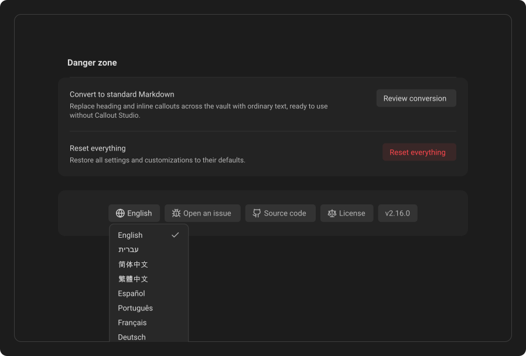
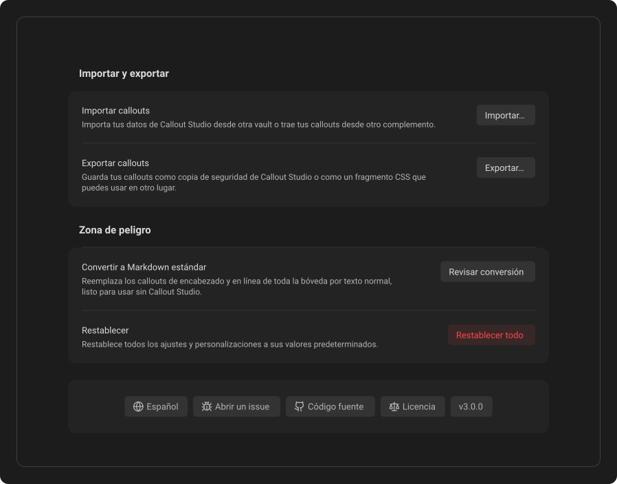

# Languages

Callout Studio supports more than thirty interface languages. By default, it follows the language already selected for Obsidian.

## Choose a language

Open **Settings → Callout Studio**, scroll to the bottom, and press the globe, which shows the language Callout Studio is in now. A menu lists every language under its own name. Scrolling the settings page closes the menu; scroll inside the list to look through the languages.

Until you choose a language, the menu has a check mark beside the language Obsidian is using, and Callout Studio keeps following it, even if you change Obsidian's language later. If Callout Studio has no translation for Obsidian's language, it shows English.

To follow Obsidian's language again after choosing another, open the menu and choose Obsidian's language.

Obsidian's language is set separately on each device, but your choice here syncs with the rest of Callout Studio's settings. If you choose a language, every device uses it. If you follow Obsidian, each device uses its own Obsidian language.

Changing this option affects only Callout Studio's settings, buttons, and messages. The **Restore an earlier version** page also uses your selected language for version names, deletion confirmations, and the **What changed** heading.

## Download once, use offline

The first time you select a language that is not already stored on the device, Callout Studio needs a brief internet connection to download it. After that, the translation is saved locally and works offline.

While it downloads, a **Downloading translation…** message appears in the corner, with the brush painting beside it. When the language arrives, Callout Studio switches to it and tells you so. If the download fails, for example because you are offline, a message says so and offers **Retry**. Callout Studio stays in its current language and tries again the next time Obsidian starts. You can also choose the same language in the menu again to retry. The same message appears whenever you open the settings while your language is still missing.

A language you have already downloaded switches at once, without a message.

## Help improve a translation

Non-English translations were created with AI assistance, so an awkward phrase or small error may remain. Press **Open an issue** (the bug) in the row at the bottom of the plugin settings to report a correction or suggestion. Say which language and which text should change.

See [Privacy & permissions](../internals-docs/25-privacy-and-permissions.md) for how translation files are downloaded and stored.

---
**Next:** [Find callouts](12-find-callouts.md)
