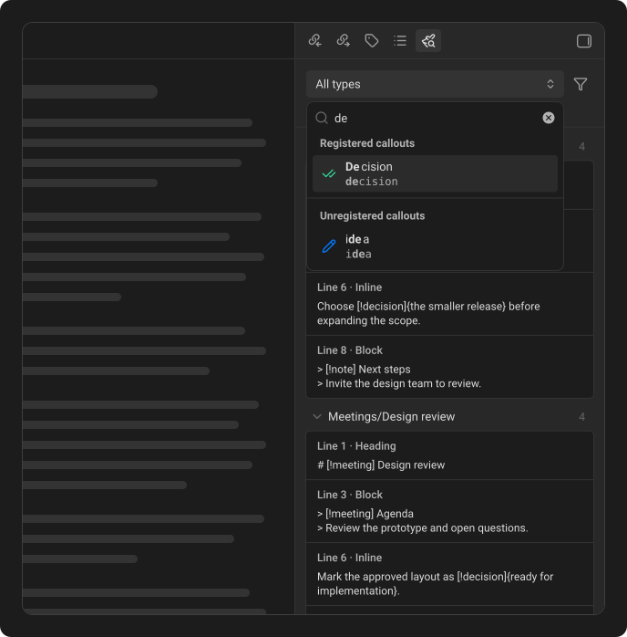
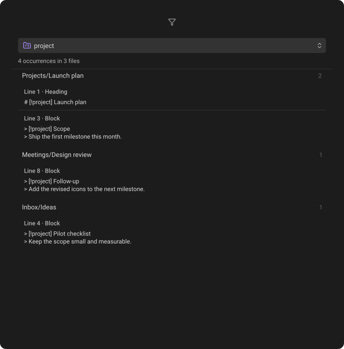

# Find callouts

**Find callouts** is a sidebar panel that answers "where did I use this
callout?" It lists every source reference to a callout across your Markdown
notes, lets you filter them by type and format, and jumps to the exact line.

## Open the sidebar

The **Find callouts** tab is added once to Obsidian's right sidebar when you
first install Callout Studio. Select it to open the panel; the sidebar does not
open automatically. If you close the tab, it stays closed on later launches.
Updating Callout Studio does not add it again.

You can reopen it with **Callout Studio: Find callouts** in the Command palette,
or **Find callouts** in a callout's three-dot menu. Obsidian then remembers its
presence and position as part of your workspace. Collapsing the sidebar or
selecting another tab does not close it, and loading a saved workspace that
contains the tab can restore it.

This is the only on-screen occurrences control; there is no separate ribbon
button or statistics window in Settings. The sidebar helps you filter callouts
and navigate to their Markdown source.

Opening **Callout Studio: Find callouts** from the Command palette starts
with **All types** and **All formats**. Opening **Find callouts** from a callout's
three-dot menu starts with that callout type and **All formats**, even if you
previously selected a different format in the sidebar.

The sidebar starts like Obsidian's **Search** pane: a small filter icon at the
top, then the type picker across the pane, then the matching-result summary
over a thin line. The filter icon opens the formats, with a check mark beside
the one shown, and stays highlighted while you show only one format. On a
phone, the filter icon sits at the bottom of the sidebar, as Obsidian's own
pane buttons do. The picker and summary remain fixed while the file groups
below scroll. Several inline callouts on one line count as separate
occurrences. The former vault-wide statistics cards are no longer shown here.

*The type picker includes registered callouts and unregistered types found in notes. Here, a search for “de” shows choices from both groups.*

Use the searchable type picker to choose **All types**, a saved type,
or an unregistered type found in your notes. The iconless **All types** option
appears first under **Browse**. It shows every callout occurrence in the vault,
including unregistered types. **Registered callouts** follow, then
**Unregistered callouts**. **Browse** and the other group headings stay visible
while you scroll the picker. The type choices use the same group styling as the
color picker.
When you choose a single type, the picker shows its ID; saved types include
their aliases in the results. Equivalent source spellings share one
option, and a registered alias does not create a duplicate option. Unregistered
options update as notes change and are available **only in this sidebar**.
Selecting one never saves or registers it, or adds it to any other settings
picker. Use **My callout types → Scan for callouts** to register it.

Unregistered choices use the icon and color from **Default fallback callout**,
just as they would after **Scan for callouts**. If the active theme owns a type,
the picker shows its measured theme appearance instead. Changing the fallback
updates these choices without registering them or changing the selected type.

Built-ins and saved definitions are available even without occurrences. A type
provided only by a theme is offered here when it occurs in a note; an unsaved
editor preview alone does not add an option.

If the last occurrence of the selected type is removed, the sidebar keeps that
selection and shows zero matches. It does not switch to another type while you
are editing. Once you select a different type, an unused unregistered type drops
out of the picker.

## Navigate through occurrences

*Choose a type to see its source references, grouped by note. The results scroll below the fixed filters and summary.*

Results are grouped by note, as Obsidian's **Search** pane groups them: the note's name with a small count at the end, then one rounded box with a row for each occurrence, separated by thin lines. The count covers matches the
list has not loaded yet. Each row shows its format, line number, and at most
two lines of raw Markdown, including syntax such as `> [!info]`. Block previews
include a line of body text when available. From the filter icon, choose **All formats**, **Block**,
**Heading**, or **Inline** to filter the selected type or all types. With a mouse or
trackpad, hovering a result tints it, as a search match does; keyboard focus
draws a ring inside the row.

A summary below the controls shows the matching occurrences and files, such as
**131 occurrences in 15 files**. It uses the same styling as the conversion
selection summary. Only the results scroll. When reading your notes takes a
while, a thin line runs across the top of the results, as in Obsidian's
**Search**; if some notes cannot be read, a line in orange says so. Select a
row to navigate. Clicking a result highlights that row with a soft grey fill, as Obsidian's **Outline** marks the current heading, and keeps it in the
same sidebar position. The row stays highlighted until you click or type in the
note; from then on the highlight follows your cursor (see
[Follow your cursor](#follow-your-cursor)). Clicking the file heading opens the
note at its beginning without moving its cursor. Switching to another note moves
the highlight to the row your cursor is in there, if any; the new note's name
takes a grey background, as the current file does in Obsidian's file list. Updating the list keeps
keyboard focus on the same occurrence when its source is unchanged.
Ctrl-click (Command-click on macOS) opens a new tab. The list initially shows
up to 100 results, and loads more as you scroll down it, as Obsidian's Search does.

The results use the full width of the sidebar, however wide you make it. The
file groups and rows use the same layout as **Review conversion**.

The current Markdown note's file heading is highlighted in the results. The
sidebar opens at the top with the filters visible, even if that note's section
is farther down the list. When you switch to another Markdown tab directly, the
sidebar scrolls to that note's section. It reveals more results first if the
section is beyond the initial page. If the current filters leave that note
with no matching occurrences, the list stays in place. Choosing a different
type or format keeps the sidebar near its current position in
the updated results.
If the filtered list is shorter, the scroll position settles at the nearest
available place. The highlighted note does not pull the list to its section
after a filter change.

Navigation opens the note in editing mode and scrolls the callout into view. A
note in Reading view opens in your default editing mode (**Settings → Editor →
Default editing mode**), Live Preview unless you changed it; a note you are
already editing stays in Live Preview or Source mode, whichever it was in. A
callout that fits on screen is centred; a taller one is aligned by its top. If
the callout is inside a folded section, that section unfolds. Navigation does not
select the callout or move the cursor, so the callout stays rendered instead of
showing its Markdown. Keyboard focus stays in the sidebar, so you can keep moving
through results, and on a phone or tablet the on-screen keyboard does not open.
To edit the callout, click or tap it in the note.

Instead of a selection, the callout briefly glows in its own colour: a ring and
a soft tint. Nothing moves or resizes, so a wide block is never clipped at the
edge of the editor. Block, heading and inline callouts all flash this way. In
Source mode the callout's lines are tinted instead. On a phone or tablet the
sidebar closes first, and the glow starts once the note is visible.

If that note is already the most recent main-pane editor, navigation reuses it
even when duplicate tabs are open. Switching away, changing the filters, or closing the sidebar while a
result is still opening cancels it.
Locations are revalidated against the current editor. Missing or ambiguous
occurrences trigger an automatic update instead of jumping to unrelated text.
On hosts where Settings cannot be dismissed automatically, close Settings to
reach the opened sidebar.

### Follow your cursor

While you edit a note, the row for the callout your cursor is in is
highlighted, much as Obsidian's **Outline** highlights the heading you are in:

- an inline callout, while the cursor touches it;
- a heading callout, while the cursor is on its heading line;
- a block callout, while the cursor is anywhere inside it.

In nested callouts, the innermost callout with a row in the current results
wins, so a filtered-out inner callout passes the highlight to the one around it.
When the cursor is in no callout, no row is highlighted.

If the highlighted row is outside the visible part of the list, the sidebar
scrolls just far enough to show it in full. It never takes keyboard focus, and it
does not load rows the list has not reached yet.

The highlight follows the cursor, not scrolling: scrolling the note without
clicking leaves it where it is, and Reading view, which has no cursor, highlights
nothing. While you type on a callout's first line, the highlight can briefly drop
out until the list catches up with your edit.

## Usage counts in menus

A callout's three-dot menu shows **Find callouts** with its total across all three
formats. Select it to open those results. Definition menus include the type's
aliases, so their occurrences contribute to the total. When no note uses the
callout, **Find callouts** shows 0 and is greyed out, since there is nothing to open.

When the count is already current, the menu opens immediately with the number.
Otherwise it waits up to 200 milliseconds for the shared scan. If the count is
ready within that time, the menu opens with it; if scanning takes longer, the
menu opens with **Find callouts**, and the number fades in when ready. Opening
another callout's menu reuses the same index rather than scanning the vault again.
Clicking elsewhere, scrolling the settings list, rotating the device, or closing
Settings cancels a pending menu opening; on desktop and tablet, so does resizing
the window. On desktop and tablet, list scrolling and viewport changes also
close an already-open menu. On a phone, the menu at the bottom of the screen
opens and stays open while the keyboard closes and the page adjusts. Rotation
and closing Settings still dismiss it.
Scrolling inside the menu itself stays available on every device.
The fade respects your system's reduced-motion preference. Incomplete scans are
labelled rather than reported as zero. Actions that change notes check current
contents separately.

## Scanning behavior and exclusions

There is no automatic discovery or unconditional startup scan. Opening a usage
surface, including selecting **Find callouts** or restoring an already-open
sidebar, builds an in-memory index. Adding the inactive tab on first install
does not start a scan. Subsequent requests reuse the index, and saved-note
changes and edits in open Markdown editors are reflected automatically after a
short delay.
There is no manual Refresh button. Nothing is uploaded or written to plugin
settings by this index. Brief scans and updates stay quiet;
if one remains in progress for two seconds, its status appears above the results.

Fenced and indented code, inline code (including multiple-backtick and multiline
spans), YAML frontmatter, and Obsidian `%%` comments are excluded. Escaped tokens,
Markdown-link labels that match callout syntax, and wikilink references are not
usages. Whitespace and indentation are interpreted in their Markdown context.

Counts describe source references, not the number of visible widgets. Existing
incomplete inline content payloads and nested payload tokens remain source
references even when a renderer does not show a pill. Theme-owned heading/inline
syntax is also counted as source, regardless of whether that format is rendered.

Open editors contribute their current text, including changes not yet saved;
closed notes use saved Markdown. If files cannot be read, the sidebar labels
the available results as incomplete and lists the affected notes. Later source
changes or reopening the sidebar trigger another attempt; failures do not start
an endless retry loop.

---
**Next:** [Syncing & backups](13-syncing-and-backups.md)
