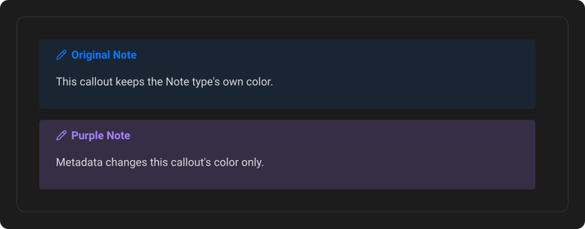
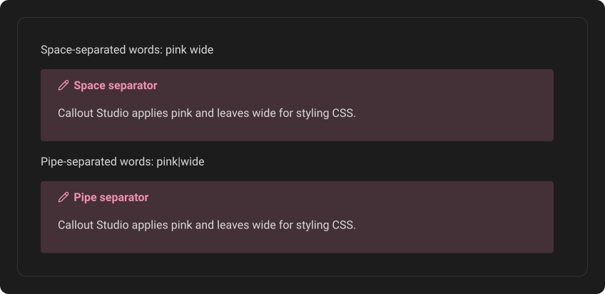
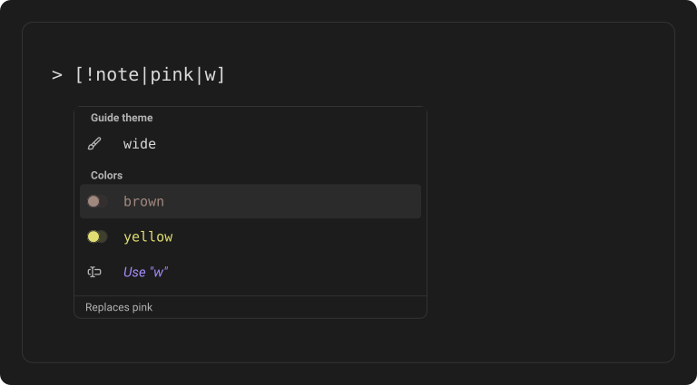

# Callout metadata

Obsidian lets you add words after a pipe in a callout's brackets: `[!note|wide]`. These words are called metadata. They change one callout without changing its type. Callout Studio reads them for one thing, color. Your theme and other plugins can read the same words for their own features.

## Color one callout

Write a color after the pipe to paint that one callout in it. Every other callout of the same type keeps its own color.

```md
> [!mark|pink] Sequence break
> ...

> [!mark|purple] Page break
> ...
```

It works the same in all three forms:

```md
## [!mark|pink] A pink heading callout

A pink [!mark|pink] inline callout, and one [!mark|pink]{with its own text}.
```

The callout takes the whole color: accent, background and gradient. When the color has no gradient, a gradient the callout's type has is cleared, and so is a title sweep. The text takes the color's own text color when it has one; otherwise it keeps your theme's text color. The callout's icon shape and its title text stay its own. (On a callout your theme draws, see [below](#when-your-theme-draws-the-callout).)



### Which words are colors

| Words | What they are |
| --- | --- |
| `blue`, `cyan`, `green`, `orange`, `red`, `purple`, `gray` | The colors of Obsidian's own callouts, under **Obsidian callouts** in the color menu |
| `coral`, `yellow`, `teal`, `sky`, `indigo`, `grape`, `plum`, `pink`, `brown` | Callout Studio's other colors, under **Color presets** |
| `grey` | Another spelling of `gray` |
| Your saved palettes | Their name in lowercase, with dashes for spaces |

The words stay in English whatever language the interface uses.

A saved palette called **Comic Red** is written `comic-red`. The palette editor shows each palette's word under its name. **Save** stays dimmed when you give a palette a word another saved palette already has. Two palettes saved before metadata words existed can share one, such as **Note dark** and **Note (dark)**; they still save, and only one of them answers to the word. A saved palette named like a built-in color takes that word over. For example, a palette you called **Pink** before the Pink preset existed keeps `pink`.

Changes to a saved palette show up in your notes right away, even when no callout type uses the palette and only its word does. A new palette's word works as soon as you save the palette. An edited palette repaints every callout that uses its word. A deleted palette's word stops coloring callouts.

Capital letters A to Z don't matter: `PINK` works like `pink`. Other capitals do, because the stylesheet that paints the colors only ignores the case of A to Z: a palette called **Émeraude** is written `émeraude`, and `Émeraude` doesn't find it.

### Removing the color

Delete the word, and the callout goes back to its own color right away. A pipe with nothing after it, `[!mark|]`, does nothing.

## Several words in a row

Separate words with spaces or with pipes, in any order. For Callout Studio these are the same:

```md
> [!mark|pink wide]
> [!mark|pink|wide]
> [!mark|wide | pink]
```

A no-break space (Option+Space on a Mac) doesn't separate two words.

Callout Studio leaves words it doesn't know alone. They are for your theme or for another plugin.



Themes are pickier than that. Each theme decides how it reads its own words:

- **ITS Theme** (and themes built on it, such as Cyber Glow), **Dune**, **Ribbons** and **Sanctum** only see words separated by spaces. `[!note|pink wide]` works with them, `[!note|pink|wide]` does not.
- **flexcyon**, **Blue Topaz**, **Notation 2**, **Elegance** and **Willemstad** find their words with either separator.
- Some words only work alone, as the first word, or as the last word. MagicUser's sizes and Ebullientworks' `left`/`right` are examples.

The autocomplete menu knows each word's rule. It only offers a word where it would work, and says when a word needs spaces, has to come first or last, or only works on its own.

## Typing metadata with the autocomplete menu

In the menu that opens after `[!`:

- **Enter** writes the callout and moves on, as always.
- **Tab** writes the callout's ID and leaves the cursor before the `]`, so you can add metadata.
- **|** completes an ID you were halfway through and types the pipe, which opens the metadata menu. When there is nothing to complete, it is just typed.

Neither key adds or rewrites the `]`, so typing it yourself still works as usual.

The metadata menu lists the colors (your saved palettes, Obsidian's colors and the extra presets), then [your own words](#your-own-words), then the words your theme and your enabled CSS snippets react to. Each group is in alphabetical order. Each color shows its word beside the same circles as the color menu in the callout editor: three when the palette has a gradient. When the menu has words from more than one place, each group has a heading, such as **Colors** or the theme's name, that stays on top while you scroll. A thin line separates the groups.

Type to filter it. Words that start with what you typed come first. You don't need the dashes: `comic red` and `comicred` both find `comic-red`, and picking it writes `comic-red`.

Anything a word needs in order to work, such as spaces around it, appears on a line at the bottom of the menu for the highlighted word. A color works with spaces or a `|`, and the line says so.

- **Tab** writes the word and stays inside the brackets. Type a space or a `|` to add another word.
- **Enter** writes the word and finishes the callout, just like Enter in the first menu.
- **Done**, at the top after a space or a pipe that follows a word, finishes without adding a word.
- **Use "…"** keeps a word that isn't on the list. It is always at the bottom of the menu, below a line of its own.

After the first color, the colors move below the theme's words, and the line at the bottom says **Replaces …** for each one. Picking one swaps the color instead of adding a second.



## Metadata settings

Open **Settings → Callout Studio**, then **Autocomplete and metadata** under **Editor**. The page has two boxes: **Callouts** holds the settings for the menu after `[!`, and **Metadata** the ones below.

- **Metadata colors** turns the colors in this chapter on or off. While it is off, `[!note|red]` is an ordinary note callout again and the menu offers no colors. Words in your notes are not changed, so turning it back on brings the colors back.
- **Metadata autocomplete** turns the menu after `|` on or off. It doesn't depend on **Callout autocomplete**, the switch for the menu after `[!` (see [Create your first callout](02-create-your-first-callout.md)): each menu can be on while the other is off.
- **Include your theme's words** shows the words your theme reacts to in that menu. It appears only while your theme reacts to some, or while it is off. Words from your own CSS snippets always show. A color still says **Your theme also styles this word** when that is true.
- **Your words**: see below.

### Your own words

Add words you want the menu to offer, such as the ones another plugin reads (Callout Metadata's `50` or `center`) or ones your own CSS uses in a way Callout Studio can't find. Type a word and press **Enter**. A space or a `|` also ends a word, so you can type or paste several at once. Each word appears as a pill; click its **×**, or select it and press **Backspace**, to remove it.

Your words come first among the words in the menu, under the heading **Your words**, and can go anywhere in the metadata. A word that is also a color shows once, as the color. Adding a word only adds it to the menu: it doesn't style anything by itself.

## Two colors in one callout

Write one color. If a callout names two, the result doesn't depend on their order:

- a saved palette wins over a built-in color;
- Obsidian's colors win over the extra presets.

## When your theme or a snippet uses the same word

Some themes react to color words themselves. Dune reads `red`, `blue`, `green` and `gray`, and Notation 2 and Blue Topaz read `pink` and others. With such a theme, both the theme and Callout Studio color the callout, and the theme may win the background. The line at the bottom of the menu says **Your theme also styles this word** for these words. Other plugins that read color words, such as Callout Metadata, color those callouts too.

A word that one of your own CSS snippets styles is left to that snippet. Callout Studio doesn't color it, and the menu shows it as the snippet's word, not as a color. This includes a saved palette's word.

## When your theme draws the callout

Some themes draw Obsidian's built-in callouts themselves (Lumines draws all thirteen), and Callout Studio leaves their look alone (see [Theme integration](17-theme-integration.md)). A color you write after `|` is different: you asked for it on that one callout, so a block callout like `[!note|red]` takes it anyway. Besides the accent and the background, Callout Studio then also colors the frame, the title and the icon, which such a theme paints from its own colors. Every other `note` keeps the theme's look.

This is the best Callout Studio can do from outside the theme. A theme that draws a callout in a way of its own, such as a stripe made with a shadow, may keep some of its own color. Heading and inline callouts of a type your theme draws aren't available, because they stay plain text there, so the menu offers no colors for them. The exported CSS snippet leaves this part out, because it doesn't know your theme.

## Renaming or deleting a palette

Renaming a saved palette changes its word. If your notes use the old word, **Save** first opens **Update your notes?**, the same question the callout editor asks. It says what changed and how many callouts in how many notes use the old word, and offers two answers:

- **Leave them as they are** is chosen when the window opens. Your notes don't change, and those callouts go back to their own color.
- **Change them to** the new word rewrites only that word and offers **Undo**.

**Save changes** saves the palette with your answer. **Cancel** takes you back to the palette editor, and nothing is saved.

It doesn't ask when the old word also means something else: a built-in color's word, such as `pink` for a palette called **Pink**, or a word your theme or a snippet styles. Those notes may mean that other thing, so they stay as they are and take that meaning.

Deleting a palette never changes your notes. Callouts that name it go back to their own color, or take the built-in color of that name when there is one.

## Where it works

Metadata colors work in Reading view, Live Preview and PDF exports. The CSS snippet you can export (see [Import, export & sharing](10-import-export-and-sharing.md)) includes them for block callouts. They need a recent engine: iOS 16.5 or later on iPhone and iPad, and on a computer an up-to-date Obsidian installer. Where it is older, callouts simply keep their own colors.
